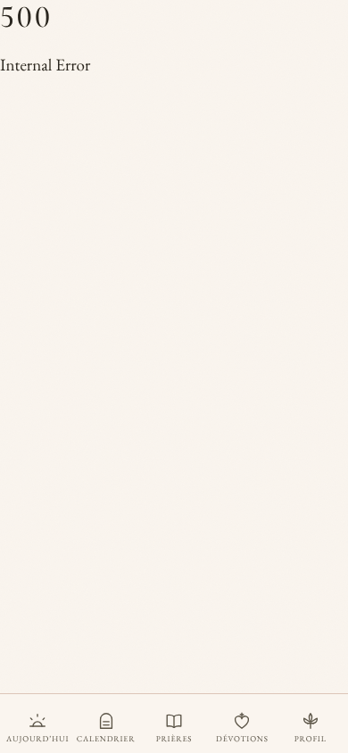
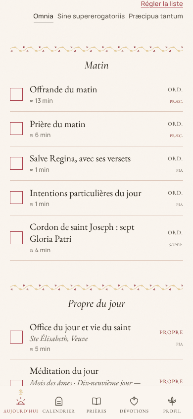

# Audit d'ergonomie et d'intuitivité (18-20 novembre 2026)

Agent « Ingénieur-concepteur ». Lecture seule du code de l'app ; seuls des tests ont été ajoutés.

## Méthode

- Build de production (`npm run build`), servi par `vite preview` ; parcours avec Playwright (Chromium), largeur iPhone
  390 × 844, `deviceScaleFactor: 1`, `fr-FR`, fuseau Europe/Paris.
- Premier lancement : « Entrer au jardin », puis 10 s d'amorçage. Pages vues : Aujourd'hui, `/liste`, `/prieres`, une
  prière, `/devotions`, `/calendrier` (mois, semaine, année), `/roue`, `/reglages`, `/profil`, `/historique`,
  `/imprimer`, `/meditation`, `/saint`, `/ecriture`, `/recueils`, `/fetes`, `/mois`.
- Erreurs relevées : `pageerror` et `console.error`. En navigation normale sur une base neuve, **aucune erreur** ; seuls
  des avertissements du service worker (« preload … cross-world service worker resource mismatch »), sans effet.
- Les doublons du jour ont été recomptés à partir de la base réellement amorcée (export d'IndexedDB), ligne par ligne et
  jour par jour : ils confirment l'audit des dévotions (`AUDIT_DEVOTIONS_2026-11-18.md`, § 1.3).
- Captures (allégées, 64 couleurs) : `docs/audits/ergonomie-2026-11-18/`.

Hauteur des pages, en écrans d'iPhone (844 px) :

| Page | Hauteur | Écrans |
|---|---|---|
| Aujourd'hui | 4 650 px | 5,5 |
| Régler la liste (`/liste`) | 4 803 px | 5,7 |
| Prières | 57 585 px | **68** |
| Dévotions | 4 360 px | 5,2 |
| Imprimer | 14 847 px | 17,6 |
| Méditation | 6 303 px | 7,5 |

---

## 1. Bug « Internal Error » de l'Historique

### Constat



Reproduit à coup sûr : base amorcée, quelques coches sur **plusieurs jours passés**, puis Profil (`/reglages`) →
Historique. La page affiche « 500 / Internal Error », sans gabarit, sans retour.

| Données fabriquées dans IndexedDB (base `hebdomada`) | Résultat | Erreur |
|---|---|---|
| Base neuve, rien de coché | correct (« Rien n'a encore été coché ») | — |
| Une coche aujourd'hui | correct | — |
| **Coches sur 2 jours passés ou plus** | **Internal Error** | `each_key_duplicate` |
| Pratique sans `regle` | Internal Error | `TypeError: … reading 'genre'` |
| Élément de liste sans `jours` ni `rappels` | Internal Error | `TypeError: … reading '4'` |
| Coches d'un élément supprimé (aujourd'hui et il y a 3 jours) | Internal Error | `each_key_duplicate` : la coche orpheline est ignorée, mais le premier jour coché recule de 3 jours, ce qui suffit à la cause ci-dessous |
| Règle `avant_fete` sans `jourSemaine` | **page figée** (boucle infinie) | — |
| Règle `consecutifs` avec `debut` vide, règle de genre inconnu | correct | — |

### Cause chez l'utilisateur : des clés de boucle en double

`app/src/routes/historique/+page.svelte`, l. 133 et 149 :

```svelte
{#each regularite.sort(…) as r (r.titre)}
{#each suiviPratiques as r (r.titre)}
```

La clé d'une boucle Svelte doit être unique ; elle est ici le **titre**. Or plusieurs lignes portent le même titre :

- les sept lignes « Litanies du jour » (`liste:24`, `liste:24-1` … `24-6`), qui gardent le même titre après leur division
  par jour (`diviserLitanies`, `reparerLitanies`) ;
- les pratiques du plan importées pour **deux années liturgiques** (`importerPlan` : `y - 1` et `y`), par exemple
  « Neuf premiers vendredis du mois » 2025 et 2026.

Une ligne n'entre dans le tableau que si elle a des jours prévus depuis le premier jour coché. Avec une seule coche
aujourd'hui, une seule « Litanies du jour » est prévue : pas d'erreur. Dès que les coches couvrent deux jours de la
semaine, deux « Litanies du jour » sont prévues, et Svelte 5 lève `each_key_duplicate`, **en production aussi**
(`node_modules/svelte/src/internal/client/dom/blocks/each.js`, l. 362). SvelteKit, faute de page d'erreur propre,
affiche alors « Internal Error ».

Cela explique les trois traits du signalement : le bug ne paraît pas sur une base neuve (rien de coché) ; il paraît à
chaque passage (les données ne changent pas) ; il ne touche que l'Historique (seule page à utiliser le titre comme clé :
`grep` sur `{#each … (….titre)}`).

La piste des pratiques sans règle est réelle, mais elle ferait aussi planter Aujourd'hui, Dévotions et les rappels, qui
appellent tous `occurrences()` (onze appelants d'après le graphe du code). L'utilisateur ne le signale pas : ce n'est
donc pas sa cause, mais une fragilité à corriger en même temps.

### Correction proposée (lot 0 du document de conception)

1. Clés par **identifiant** : `(r.id)` dans les deux boucles (ajouter `id` aux objets de `regularite` et de
   `suiviPratiques`).
2. Tolérance aux données incomplètes : `e.jours?.[j] ?? true`, `e.rappels?.length ?? 0`, `p.regle?.genre` ; dans
   `occurrences()`, renvoyer `[]` pour une règle absente ou invalide, et borner la boucle `while` d'`avant_fete` (sept
   tours au plus ; `jourSemaine` absent traité comme `null`).
3. `importerPlan` : ne pas réimporter, pour l'année précédente, une série déjà passée ; à défaut, distinguer l'année dans
   le titre affiché.
4. `app/src/routes/+error.svelte` (gabarit de l'app, message réel, bouton « Copier le rapport », lien vers Aujourd'hui) et
   `app/src/hooks.client.ts` (`handleError` qui renvoie `error.message` au lieu de « Internal Error »).

### Tests qui attrapent le bug

- `app/tests/historique.e2e.mjs` : lance `vite preview`, amorce une base, fabrique les données ci-dessus et passe de
  `/reglages` à `/historique`. Aujourd'hui : **3 échecs sur 5** (coches anciennes, pratique sans règle, élément
  incomplet). Lancer après `npm run build` : `node tests/historique.e2e.mjs`.
- `app/src/lib/donnees-anciennes.test.ts` (vitest) : `occurrences()` sur des règles incomplètes, dont la boucle infinie
  (exécutée dans un fil séparé avec délai). Les deux cas aujourd'hui fautifs sont marqués `it.fails` : la suite reste
  verte, et deviendra rouge le jour de la correction, ce qui obligera à retirer `.fails`.

---

## 2. Problèmes majeurs, par ordre de gravité

### 2.1 Aujourd'hui : trop long, trop chargé, et faux

 

- **5,5 écrans**, 23 à 26 lignes ; « Temps de prière : 2 h 34 » à 2 h 41 annoncés. La première case à cocher n'apparaît
  qu'au deuxième écran.
- Avant la liste, quatre blocs de chiffres : jardin du jour, temps de prière, indulgences (« sur 89 ans et 13 300 jours
  pour la liste entière »), bilan (« 4 manquent », en texte simple, pas en bouton), puis « Régler la liste », puis trois
  seuils **en latin** (« Omnia / Sine supererogatoriis / Præcipua tantum ») dont le sens n'est dit nulle part.
- Le total d'indulgences additionne des concessions **abrogées** (Beringer, Thésaurisons) : contraire à la règle du
  19 novembre (Enchiridion de 1952 seul).
- Chaque ligne porte deux étiquettes (« ORD. » / « PROPRE » et « PRÆC. » / « PIA » / « SUPER. ») : du jargon, répété
  26 fois, qui n'aide pas à prier.
- **Doublons** : chaque jour de la semaine, au moins un texte paraît deux fois (dimanche : litanies de la Trinité ;
  lundi : De profundis et chapelet des Morts ; mardi : chapelet de saint Michel ; mercredi : prière pour la pureté et
  litanies de saint Joseph ; vendredi : Devant le Crucifix et litanies du Sacré-Cœur ; samedi : litanies de la sainte
  Vierge, et le don de crainte inclus dans le Cœur affligé). Recompté sur la base amorcée : **10 doublons par semaine**
  entre lignes, plus une inclusion ; l'audit des dévotions en compte 26 avec le plan et les mois.
- Prière et lecture mêlées : office du saint, méditation, roue, mois, Petit bréviaire (44 à 49 min de lecture comptées
  comme prière).
- Lignes vides comptées comme tâches : « Intentions particulières », « Dévotion du mois » (5 min fixes), « La roue du
  jour » (3 min fixes).
- Le martyrologe, en bas, ajoute un écran et demi d'invocations.

### 2.2 Navigation : deux « Profil », des éditeurs cachés


- L'onglet **Profil** ouvre `/reglages`, titré « Profil » ; sa première entrée ouvre `/profil`, titré « Profil
  spirituel ». Deux pages pour un même mot.
- `/reglages` mélange tout : liens (profil spirituel, historique, roue, imprimer, fêtes), compte, rappels, éditeurs
  (« Liste du jour », « Pratiques et dévotions », « Fêtes »), apparence, sauvegarde, corbeille.
- L'éditeur de la liste n'est atteint que par le petit lien « Régler la liste » d'Aujourd'hui, ou au milieu des réglages.
- La roue a une place d'onglet dans les réglages et une ligne dans la liste : elle est à la fois lecture, dévotion et
  réglage.
- Pas d'onglet Lecture : l'Évangile (`/ecriture`), la méditation (`/meditation`), le saint (`/saint`), les recueils
  (`/recueils`) ne sont atteints que par des lignes de la liste ou des liens internes.

### 2.3 Régler la liste : un gabarit brut affiché


- **Bug visible** : chaque ligne affiche le texte brut `{e.roue ? ', par la roue' : ''}`
  (`app/src/routes/liste/+page.svelte`, l. 211 : une expression Svelte écrite à l'intérieur d'un gabarit JavaScript).
- 5,7 écrans ; les sept « Dévotion du ‹jour› », les sept « Litanies du jour » et les sept « Demande du don » paraissent
  chacune comme une ligne : 21 lignes pour trois pratiques.
- Deux lignes génériques (« Dévotion à jours comptés en cours », « Neuvaine ou trentain en cours ») ne correspondent à
  aucun texte : elles sont remplacées à l'affichage par les pratiques du jour. Le modèle mental n'est pas lisible.

### 2.4 Prières : 68 écrans sans filtre de thème


- La bibliothèque entière est rendue d'un bloc (57 585 px). Seuls filtres : Toutes, Favoris, Mes ajouts, Méditations.
- Pas de filtre par **thème** (Trinité, Sacré-Cœur, Vierge, Joseph, âmes…) ni par **type** (litanies, chapelets,
  neuvaines, actes, jaculatoires), alors que `app/src/lib/etiquettes.ts` déduit déjà ces étiquettes.
- « Méditations » est un filtre de Prières, alors que c'est de la lecture.
- Doublons d'édition visibles (Flèche d'or ×2, litanies du Sacré-Cœur ×2, Triple Couronne : l'ordinaire, les trois
  propres et les trois pages composées).
- Page d'une prière : la notice en rouge italique centré peut précéder le texte de plus d'un écran (Acte héroïque) ;
  elle gagnerait à être dépliable (principe 4 du § 11).

### 2.5 Dévotions : une année entière à plat


- 40 lignes, dont 33 « à venir » sur un an ; toutes ont la même pastille « 0/N ».
- Trois boutons d'administration en tête (Ajouter, Reprendre le plan, La roue) avant le contenu.
- Grammaire : « 1 jours de suite » (Consécration, renouvellement ; `regleEnClair`).
- Les pages explicatives (cordon, scapulaire, heure sainte, Garde d'honneur…) n'y sont pas : elles sont des textes de
  la bibliothèque ou des lignes de la liste.

### 2.6 Page d'erreur

Aucune `+error.svelte` : toute exception de rendu donne « 500 / Internal Error », hors gabarit, sans bouton de retour ni
message utile. Sur iPhone, en PWA plein écran, l'utilisateur ne peut que fermer l'app.

### 2.7 Autres remarques

- **Roue** : 26 chiffres romains en couronnes, « jour 18 du grand cycle de 84 jours » ; c'est beau, mais la page mêle six
  roues, la lecture du chapitre d'Évangile et le réglage. L'Évangile du jour gagnerait à vivre dans Lecture › Écriture.
- **Imprimer** : 17,6 écrans, dont toute la bibliothèque à cocher pour le livret, sans recherche visible en haut.
- **Calendrier** : clair. Le choix Mois / Semaine / Année est bien placé.
- **Sobriété** : l'arche et les bandeaux sont réussis (traités le 19 nov.). Le reste de l'écran manque de hiérarchie :
  tout est au même niveau (filets, petites capitales, rouge).
- **Accessibilité** : cases de 30 px environ, bonnes ; les étiquettes ORD./PIA en très petites capitales sont à peine
  lisibles (≈ 9 px).

---

## 3. Recommandations (reprises dans `docs/conception/REFONTE_2026-11-18.md`)

1. Corriger l'Historique et ajouter une vraie page d'erreur (lot 0).
2. Cinq onglets (Aujourd'hui, Lecture, Prières, Dévotions, Calendrier) ; le Profil en icône en haut à droite ; un seul
   « Profil » qui regroupe profil spirituel, historique, couronnes et réglages.
3. Aujourd'hui : la liste d'abord ; une ligne « Bilan » repliée (jauges et bilan au toucher) ; seuils en français
   (« Tout », « Sans le surérogatoire », « L'essentiel ») dans le réglage, pas sur l'écran du jour ; plus d'étiquettes
   ORD./PIA sur les lignes.
4. Le programme unique : une page par pratique, une seule fois par jour, les petites pratiques insérées dans leur hôte.
5. Lecture : office, Écriture, doctrine, spirituel ; une ligne récapitulative dans Aujourd'hui.
6. Prières : filtres par thème et par type, sections repliées par partie, rendu paresseux.
7. Dévotions : « En cours », « Ce mois-ci », « Plus tard » (repliée), puis les pages explicatives.
